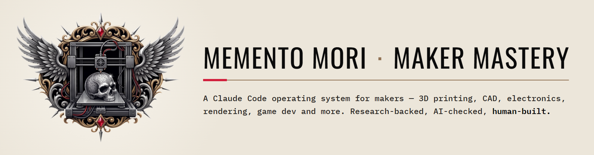
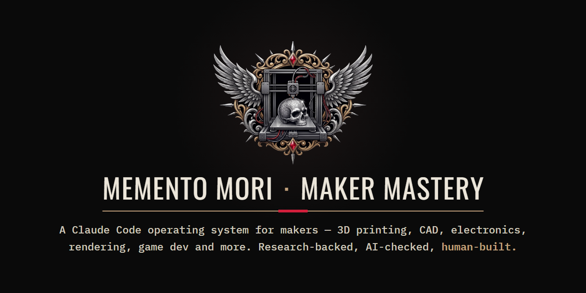
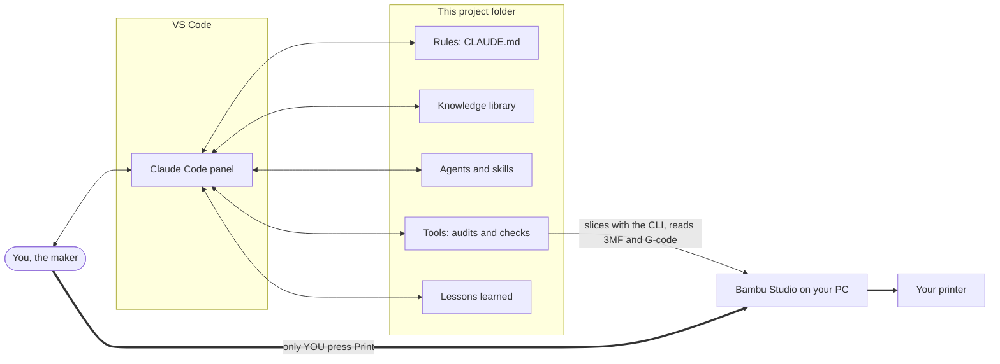
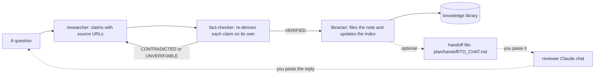
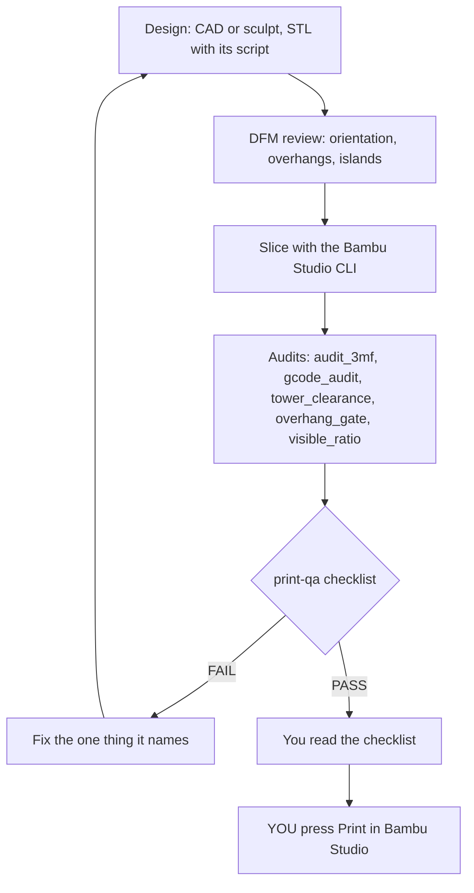

<p align="center">
  <picture>
    <source media="(prefers-color-scheme: dark)" srcset="assets/brand/banner-dark.png">
    <source media="(prefers-color-scheme: light)" srcset="assets/brand/banner-light.png">
    
  </picture>
</p>

<h1 align="center">MEMENTO MORI · MAKER MASTERY</h1>

<p align="center"><strong>A Claude Code operating system for makers — 3D printing, CAD, electronics, rendering, game dev and more. Research-backed, AI-checked, human-built.</strong></p>

Maker Mastery turns Claude Code into a careful workshop partner for any maker: 3D printing, CAD, electronics, rendering and more.
Its flagship is 3D printing on Bambu Lab printers, where Claude Code slices, audits and gates your files, and you press Print.

<!-- Badges. <owner> is the GitHub account name, filled in when the repository is published. -->
<p align="center">
  <a href="LICENSE"></a>
  <a href="docs/02-install.md"></a>
  <a href="https://code.claude.com/docs/en/vs-code"></a>
  <a href="https://wiki.bambulab.com/"></a>
  <a href="https://www.python.org/downloads/windows/"></a>
  <!-- <owner> below is filled in at publish time. -->
  <a href="https://github.com/<owner>/maker-mastery/releases">/maker-mastery/total"></a>
</p>

> [!IMPORTANT]
> **No AI ever starts, sends, uploads or queues a print.** Claude Code, every agent, every skill and every tool here may
> design, slice, audit and prepare print files. Only **you** press Print in Bambu Studio, after you have read the
> pre-print checklist. See [docs/06-print-safety.md](docs/06-print-safety.md).

## Contents

- [What is this](#what-is-this)
- [Why](#why)
- [Preview](#preview)
- [Domains](#domains)
- [How it works](#how-it-works)
- [Quick Start](#quick-start)
- [Guides](#guides)
- [FAQ](#faq)
- [Roadmap](#roadmap)
- [Contributing](#contributing)
- [Credits](#credits)
- [License](#license)

## What is this

Maker Mastery is a ready-made project folder that you open in VS Code with the Claude Code extension. It gives Claude a
rulebook ([CLAUDE.md](CLAUDE.md)), a cited knowledge library ([knowledge/](knowledge/INDEX.md)), a team of specialist
agents and skills ([.claude/](.claude/)), checking tools ([tools/](tools/)) and a set of lessons learned
([lessons/](lessons/INDEX.md)). Ask it to research a material, design a bracket, plan an LED power budget, check a
render or prepare a print, and it works from sourced facts, checks its own output with real tools, and tells you what it
could not verify. 3D printing is the flagship example: Claude can slice your 3MF with the Bambu Studio you installed,
audit the project and the G-code, and fill a pre-print checklist, and then the last step, pressing Print, is always yours.

## Why

- **Facts with sources, not guesses.** Every fact in the library links its public source; anything unchecked is labelled
  "not verified", and a fact-checker that never sees the researcher's reasoning re-derives each claim.
- **Gates that use the real slice.** Print files are judged from the sliced G-code and the 3MF itself, by tools with
  their own tests, so a clean-looking preview cannot hide a bad plate.
- **You stay in charge.** Nothing is installed, deleted or printed without you. Folders you protect are read-only for
  Claude, and the print rule is enforced in settings as well as in the rules.

## Preview

<p align="center">
  
</p>

Real output from the shipped tools, run on small synthetic test files (full samples in
[docs/tool-sample-outputs.md](docs/tool-sample-outputs.md)):

**`tools/audit_3mf.py`** checks a sliced 3MF against your recorded filament load (excerpt):

```text
3MF audit: part.3mf
  printer=Bambu Lab H2C 0.4 nozzle  process=0.20mm Standard @BBL H2C  bed=Textured PEI Plate
  [OK] C7: L1: load_filled.md Verified: 2026-01-08 (2 day(s) before 2026-01-10)
  [OK] C7: L4: filament 1 filament_colour #000000 is a catalogue colour of Bambu PLA Basic Black ['#000000']
  [OK] C15: process preset '0.20mm Standard @BBL H2C' = the printer's default, layer_height 0.2; no process key modified
  [WARN] C8: filament 1 profile 'Bambu PLA Basic @BBL H2C' not found in the installed profiles ... - compatibility unproven
VERDICT: WARN
```

**`tools/overhang_gate.py`** finds an unsupported overhang on a T-shaped test part:

```text
t_shape  pose (0.0, 0.0, 0.0)  watertight  24 faces  posed bbox [[-15.0, -5.0, 0.0], [15.0, 5.0, 24.0]]
  overhang below 30 deg: 300.0 mm2 (min angle 0.0; bbox [[-15.0, -5.0, 20.0], [15.0, 5.0, 20.0]])
  [WARN] per-layer cantilever 10.00 mm at posed z 20.10 (1 layer(s) over 0.5 mm, the --cantilever-warn acceptance value)
VERDICT: WARN
```

**`tools/tower_clearance.py`** measures the prime tower's gap to every object from the G-code:

```text
plate_1.gcode: tower all-layers [200.0, 200.0, 215.0, 215.0] first-layer [200.0, 200.0, 215.0, 215.0] (rule: gap >= 8.0 mm)
  [OK] object 1: bounds [100.0, 100.0, 136.0, 120.0] gap body 113.14 mm, first-layer 113.14 mm
  VERDICT: OK
```

## Domains

The domain map is numbered from 00 to 44. Version 1.0 ships 16 knowledge domains (✅) plus the gear template; the rest
arrive in v1.1 (⏳).
Track your own progress in [CURRICULUM.md](CURRICULUM.md).

| # | Making | Status |
|---|---|---|
| 00 | [Your gear (template)](knowledge/00-gear-inventory/README.md) | ✅ v1.0 (template) |
| 01 | [Printers](knowledge/01-printers/index.md) | ✅ v1.0 |
| 02 | [Bambu Studio](knowledge/02-bambu-studio/index.md) | ✅ v1.0 |
| 03 | [Materials](knowledge/03-materials/index.md) | ✅ v1.0 |
| 04 | [Design for FDM](knowledge/04-design-for-fdm/index.md) | ✅ v1.0 |
| 05 | [CAD, hard surface](knowledge/05-cad-hard-surface/index.md) | ✅ v1.0 |
| 06 | [Organic modeling](knowledge/06-organic-modeling/index.md) | ✅ v1.0 |
| 07 | [Engineering](knowledge/07-engineering/index.md) | ✅ v1.0 |
| 08 | [Electronics and lighting](knowledge/08-electronics-lighting/index.md) | ✅ v1.0 |
| 09 | Finishing | ⏳ v1.1 |
| 10 | Workflows | ⏳ v1.1 |
| 11 | Calibration and testing | ⏳ v1.1 |
| 12 | [Failure diagnosis](knowledge/12-failure-diagnosis/index.md) | ✅ v1.0 |
| 13 | Project ops | ⏳ v1.1 |

| # | Creative, business and design | Status |
|---|---|---|
| 14 | Creative mindset | ⏳ v1.1 |
| 17 | Creative direction | ⏳ v1.1 |
| 18 | Selling 3D prints | ⏳ v1.1 |
| 20 | Woodworking | ⏳ v1.1 |
| 21 | MakerWorld | ⏳ v1.1 |
| 22 | IP and licensing | ⏳ v1.1 |
| 24 | [Surfacing and rendering](knowledge/24-surfacing-and-rendering/index.md) | ✅ v1.0 |
| 25 | Reference sheets | ⏳ v1.1 |
| 26 | [AI to 3D](knowledge/26-ai-to-3d/index.md) | ✅ v1.0 |
| 27 | Scanning and photogrammetry | ⏳ v1.1 |

| # | Games, media, tech and safety | Status |
|---|---|---|
| 28 | Game design | ⏳ v1.1 |
| 29 | Game development | ⏳ v1.1 |
| 30 | Visual pre-production | ⏳ v1.1 |
| 31 | Retro arcade | ⏳ v1.1 |
| 32 | Audio and sound | ⏳ v1.1 |
| 33 | Animation and motion | ⏳ v1.1 |
| 34 | Video editing | ⏳ v1.1 |
| 35 | AI image and video | ⏳ v1.1 |
| 37 | Photography | ⏳ v1.1 |
| 39 | [Raspberry Pi and microcontrollers](knowledge/39-raspberry-pi-and-microcontrollers/index.md) | ✅ v1.0 |
| 40 | [Bambu ecosystem](knowledge/40-bambu-ecosystem/index.md) | ✅ v1.0 |
| 41 | [MCP](knowledge/41-mcp/index.md) | ✅ v1.0 |
| 42 | [Agent engineering](knowledge/42-agent-engineering/index.md) | ✅ v1.0 |
| 43 | Data and backups | ⏳ v1.1 |
| 44 | [Safety](knowledge/44-safety/index.md) | ✅ v1.0 |

Numbers missing from the map are reserved and are not part of this project.

## How it works

### The system



### The knowledge pipeline



### The print-qa gate



## Quick Start

1. **Install the free tools:** Git, VS Code, the Claude Code extension, Python 3.12 and Bambu Studio.
   [docs/02-install.md](docs/02-install.md)
2. **Get the project:** download the ZIP or clone it into a short folder path outside OneDrive.
   [docs/03-get-the-project.md](docs/03-get-the-project.md)
3. **Run setup once, before you open Claude Code:** in the VS Code terminal run
   `powershell -ExecutionPolicy Bypass -File .\tools\setup.ps1`. [docs/04-first-run.md](docs/04-first-run.md)
4. **Tell it about your gear:** fill `knowledge\00-gear-inventory\` with your printers and what is loaded.
   [docs/04-first-run.md](docs/04-first-run.md)
5. **Open the Claude Code panel and ask.** For example: "Read CLAUDE.md, then help me print the calibration cube in
   examples\calibration-cube." [docs/05-daily-workflow.md](docs/05-daily-workflow.md)

## Guides

| Guide | What it covers |
|---|---|
| [01 What this is](docs/01-what-this-is.md) | How the parts fit together, in plain English |
| [02 Install](docs/02-install.md) | Git, VS Code, Claude Code, Python 3.12 and Bambu Studio, click by click |
| [03 Get the project](docs/03-get-the-project.md) | Download ZIP or git clone, and where to put the folder |
| [04 First run](docs/04-first-run.md) | Setup script, config, your gear, your first prompt |
| [05 Daily workflow](docs/05-daily-workflow.md) | Asking for a part or a print, the library, the agents, the gates |
| [06 Print safety](docs/06-print-safety.md) | The no-AI-print rule, the checklist, how you send a print |
| [07 Tools reference](docs/07-tools-reference.md) | Every tool: inputs, outputs, example and sample output |
| [08 Customize](docs/08-customize.md) | Your printers, filaments, rules, knowledge, lessons and brand |
| [09 Troubleshooting](docs/09-troubleshooting.md) | The 15 most likely problems and their fixes |
| [10 FAQ](docs/10-faq.md) | Short answers to common questions |

## FAQ

<details>
<summary><strong>Do I need a Bambu Lab printer?</strong></summary>

No. The knowledge library, agents and most tools work for any maker. The slicing helper and the 3MF audit are written
for Bambu Studio and Bambu Lab printers; other printers get the general design, materials and engineering help.
</details>

<details>
<summary><strong>Can Claude start a print for me?</strong></summary>

No, by design. No tool here can start, send, upload or queue a print, and `.claude/settings.json` denies print, upload and
start tools from any MCP server. You press Print in Bambu Studio yourself.
</details>

<details>
<summary><strong>What does it cost?</strong></summary>

The project is free (MIT). Claude Code needs an Anthropic account: a paid Claude subscription or a Claude Console
account, according to the [Claude Code VS Code docs](https://code.claude.com/docs/en/vs-code). Git, VS Code, Python and
Bambu Studio are free downloads.
</details>

<details>
<summary><strong>Does it work on macOS or Linux?</strong></summary>

It is written and tested for Windows 11 only. The Python tools are mostly portable, but the setup script, the hooks and
the guides assume Windows. macOS and Linux are not tested.
</details>

<details>
<summary><strong>Is my data sent anywhere?</strong></summary>

The tools run on your PC and make no network calls. Your prompts and the files Claude reads go to Anthropic as part of
using Claude Code. Your load record and config stay on your PC; `config/paths.yaml` is ignored by git.
</details>

More answers: [docs/10-faq.md](docs/10-faq.md).

## Roadmap

- **v1.0.0 "First Light"** (this release): 16 knowledge domains, 22 agents, 30 skills, 5 commands, the print-qa gate,
  the slicing and audit tools with their self-test, 20 lessons, the calibration-cube example and the beginner guides.
- **v1.1: the full library.** The remaining domains of the map, including game design and game development, plus
  finishing, calibration and testing, workflows, project ops, creative direction, selling and IP, reference sheets,
  scanning, media and data and backups, each after the same source and privacy review.

## Contributing

Corrections, new notes, lessons and tool fixes are welcome. Read [CONTRIBUTING.md](CONTRIBUTING.md) first: every fact
needs a public source and an independent fact-check, run the privacy scan before every pull request, and nothing may add
a way for software to start a print. Security problems go through [SECURITY.md](SECURITY.md). Everyone follows the
[Code of Conduct](CODE_OF_CONDUCT.md).

## Credits

Created by @OrcusMori.

Built with [Claude Code](https://code.claude.com/docs/en/vs-code). Third-party packages, adapted code and fonts are
credited in [THIRD_PARTY_NOTICES.md](THIRD_PARTY_NOTICES.md).

## License

Code and documentation are released under the [MIT License](LICENSE). The Memento Mori name, crests, logos and every file
in `assets/brand/` are **not** covered by the MIT License; see [NOTICE.md](NOTICE.md). If you publish a fork, replace the
brand assets first.

<!--
Star history (fill <owner> when the repository is published, then uncomment):
[](https://star-history.com/#<owner>/maker-mastery&Date)
-->

---

<sub>Unofficial community project. Not affiliated with or endorsed by Anthropic or Bambu Lab. Claude and Bambu Lab are trademarks of their owners.</sub>
