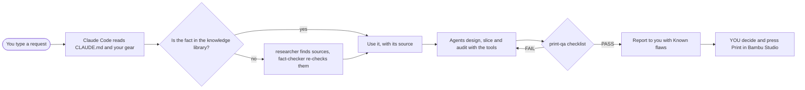

# 01 - What this is

This guide explains, in plain English, what Memento Mori Maker Mastery is and how its parts work together. There is
nothing to install on this page. Next: [02 - Install](02-install.md).

## In one paragraph

Claude Code is an AI assistant from Anthropic that works inside VS Code: you type a request in its panel, and it reads
and writes files in the folder you opened, runs commands and reports back. On its own it is a general helper. This
project is a folder that turns it into a careful maker's assistant: a rulebook it must follow, a library of facts that
each carry a public source, specialist "agents" (helpers with one job each), "skills" (ready-made procedures you start
with a `/` command), tools that check real files, and lessons from past mistakes. You open the folder in VS Code, and
Claude Code picks all of it up automatically.

## The parts

| Part | Where | What it does for you |
|---|---|---|
| Rulebook | [`CLAUDE.md`](../CLAUDE.md) | Claude Code reads it at the start of every session. It says how to work: cite sources, never guess, say what was not checked, never start a print. |
| Your gear | [`knowledge/00-gear-inventory/`](../knowledge/00-gear-inventory/README.md) | What printers you own and what filament is loaded right now. Claude answers for this gear only, and asks when it is empty. |
| Knowledge library | [`knowledge/`](../knowledge/INDEX.md) | 94 notes in 16 domains (printers, slicer settings, materials, design for FDM, CAD, electronics, rendering, safety and more). Every fact links its source. |
| Agents | [`.claude/agents/`](../.claude/agents/) | 22 specialists: researcher, fact-checker, librarian, CAD engineer, DFM engineer, Bambu Studio expert, print-qa, safety officer and more. |
| Skills and commands | [`.claude/skills/`](../.claude/skills/), [`.claude/commands/`](../.claude/commands/) | 30 skills and 5 commands you start by typing `/` in the Claude Code panel, for example `/preprint-check` or `/research-topic`. |
| Tools | [`tools/`](../tools/) | Python scripts that slice with Bambu Studio's command line and audit 3MF files, G-code and STL meshes. They have their own self-test. See [07 - Tools reference](07-tools-reference.md). |
| Hooks | [`.claude/settings.json`](../.claude/settings.json) | Small scripts Claude Code runs automatically: show the lessons when a session starts, block writes to folders you protect, check the format of a knowledge note right after it is written. |
| Lessons | [`lessons/`](../lessons/INDEX.md) | Short post-mortems of real mistakes, each with the rule that now prevents it. |
| Templates | [`templates/`](../templates/) | The note format, part spec, pre-print checklist, a new-project folder and the optional reviewer handoff. |
| Example | [`examples/calibration-cube/`](../examples/calibration-cube/README.md) | A 20 mm cube taken from a script to an audited print file. |

## How a request flows

## Three ideas behind it

1. **A fact needs a source.** If Claude cannot point to a public page or a measurement, it must say "not verified".
   That is why the library has a researcher and a separate fact-checker that never sees the researcher's reasoning.
2. **Check the real thing.** A print file is judged from the real slice: the 3MF and the G-code Bambu Studio wrote, read
   by tools with their own tests. A render is judged by looking at the rendered image, not the plan for it.
3. **You keep the last step.** Claude may prepare and check everything up to the printer. It never starts, sends,
   uploads or queues a print. Installing software, deleting files and spending money also wait for your yes.

## What it is not

- It is not an app with buttons. Everything happens through the Claude Code panel and a few PowerShell lines.
- It does not control your printer. It has no connection to it.
- It is not a replacement for your judgement. Every deliverable ends with a "Known flaws" list so you know what to check.

Next: [02 - Install](02-install.md).
